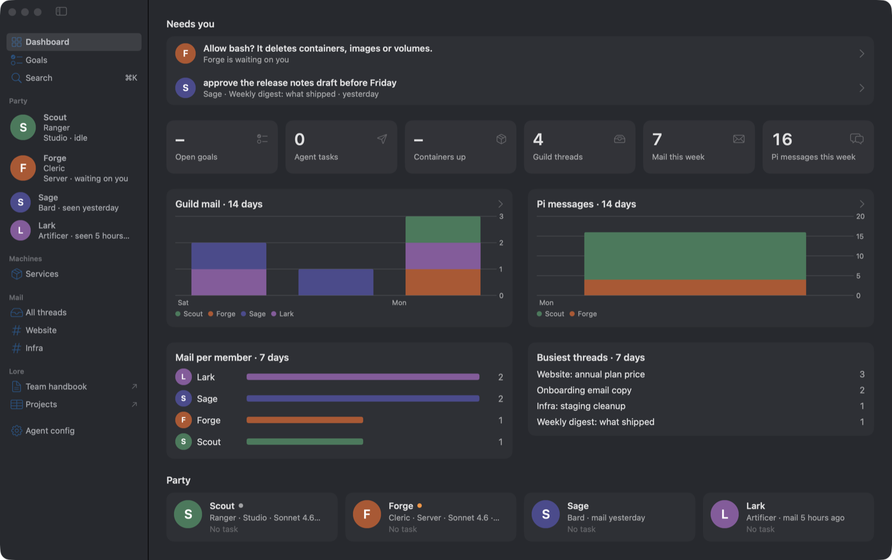
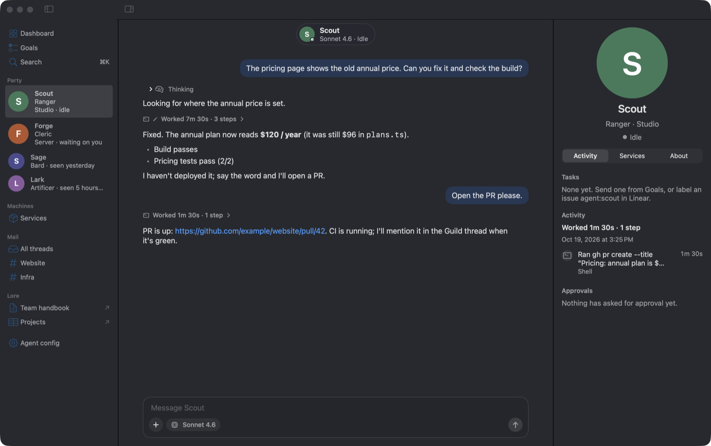
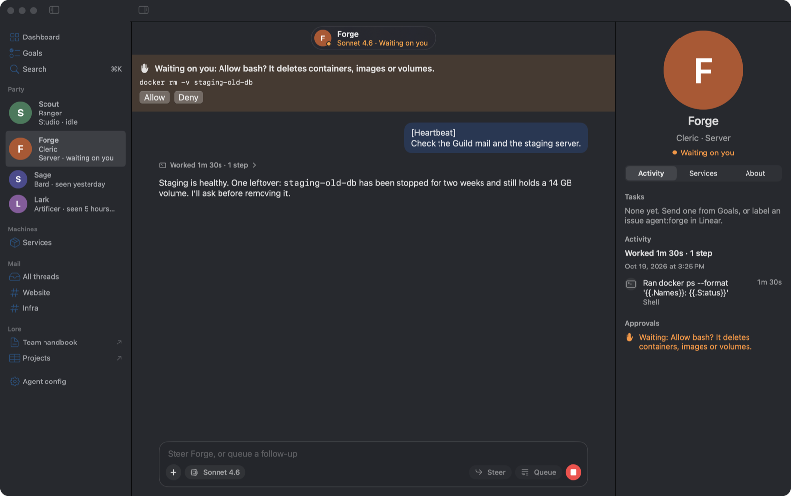
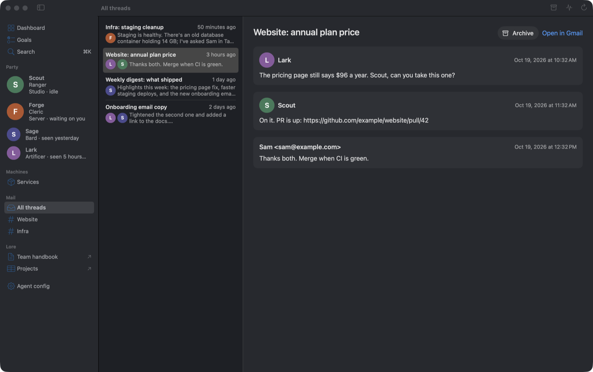

# Tavern

A native Mac app for running a party of AI agents: the ones you can steer live, and the ones
that live elsewhere and talk to you by email or iMessage.



- **Pi agents, live.** Each [Pi](https://github.com/earendil-works/pi) agent has one durable
  thread: streaming replies, tool steps, steer and queue, abort, approvals, images. Agents can
  run on this Mac or on other machines reached over SSH (see `bridge/tavern-durable`). The host
  runs each agent's `HEARTBEAT.md` every 30 minutes, and Tavern can forward new mail that greets
  an agent as an event (`mailEvents` in the roster).
- **Hosted agents.** Members you can't reach live (ChatGPT, Claude, Grok…) get a page built from
  the party's shared Gmail label, plus an iMessage conversation when they have a handle.
- **Needs you.** The Dashboard starts with what's waiting on you: agents blocked on a question,
  mail that asks for you, unanswered iMessages, failed connections and finished tasks.
- **Goals.** Your Linear team's open issues with filters, agent tags, editing, New Ticket and
  "send to an agent".
- **Services.** Docker containers on each agent's machine.
- **Lore.** Links to the party's shared docs and boards.

| A Pi agent's thread | An approval waiting on you |
| --- | --- |
|  |  |



Screenshots show a made-up party. `scripts/demo.sh` runs it (fake agents, sample mail, its own
data folder via `TAVERN_HOME`), and `scripts/screenshots.sh` retakes these images.

## Install (Apple silicon, macOS 14+)

```bash
brew install --cask thrashr888/tap/tavern
```

## Build and run

```bash
swift build
swift test
scripts/bundle.sh      # builds a release Tavern.app into ~/Applications and opens it
```

## Configure

Everything about your party lives in `~/Library/Application Support/Tavern/`, not in this repo:

- `roster.json`: the members, their machines and endpoints, the mail label, the Linear team,
  project owners and Lore links. Start from [docs/roster.example.json](docs/roster.example.json).
  Without it Tavern shows a two-member example party.
- `portrait.png` and `avatars/<id>.png`: optional party art. Members without art get an initial.
- `gmail-oauth-client.json`: a desktop OAuth client from your own Google Cloud project, for the
  mail feed (scope `gmail.modify`: Tavern reads, and archives a thread when you ask; it never
  sends or deletes). Tavern stores the token in your keychain.
- `~/.config/linear-key`: a Linear API key, for Goals. Tavern sends read queries, plus agent
  labels, new issues and edits to an issue's title, description, status, priority and project.
- iMessage uses [cider](https://github.com/thrashr888/cider) and needs Full Disk Access for
  Tavern to read your Messages history.

## Layout

- `Sources/TavernCore`: models, SQLite event store, roster, Pi RPC, Gmail, Linear, Docker. No UI.
- `Sources/TavernApp`: the SwiftUI app.
- `Tests/TavernCoreTests`: unit tests for the core.
- `bridge/tavern-durable`: the Node host that keeps one Pi Durable session per agent.

No credentials are stored in this repo.
